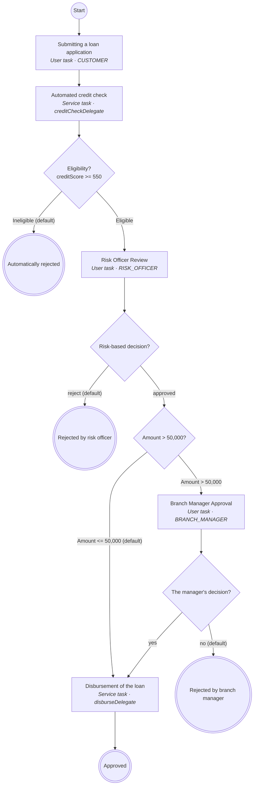

# Loan Request Workflow

An end-to-end loan request application whose real business process is modelled in **BPMN 2.0** and executed by **Activiti**, with a **Spring Boot** REST API and an **Angular** front end.

A customer submits a loan request, the system runs an automated credit check, a risk officer reviews eligible requests, and requests above 50,000 EGP additionally require branch manager approval before disbursement.

## Process diagram

The diagram below mirrors `WorkFlow-backend/src/main/resources/processes/loan-request.bpmn20.xml` (opened and editable with any BPMN 2.0 modeler, e.g. Camunda Modeler).



### Business rules

| Rule | Value |
| --- | --- |
| Minimum credit score for eligibility | 550 |
| Requests needing branch manager approval | amount > 50,000 EGP |
| Review decisions | `APPROVE` / `REJECT` (rows of the `DECISION` lookup table) |

## Tech stack

| Layer | Technology |
| --- | --- |
| Backend | Spring Boot 3.5, Java 21, Spring Web / Data JPA / Security, MapStruct, Lombok |
| Workflow engine | Activiti 8.8.1 (BPMN 2.0, user tasks + service task delegates) |
| Auth | JWT bearer token, role-based access (`CUSTOMER`, `RISK_OFFICER`, `BRANCH_MANAGER`) |
| Database | Oracle (schema configured in `WorkFlow-backend/src/main/resources/application.yaml`) |
| Front end | Angular 11 (NgModule), Bootstrap, RxJS |

## Repository layout

```
training/
├─ WorkFlow-backend/     Spring Boot API + Activiti process (port 8085)
│  ├─ src/main/resources/processes/loan-request.bpmn20.xml   BPMN definition
│  ├─ src/main/java/com/workflowtask/
│  │  ├─ controller/     REST endpoints
│  │  ├─ service/        business layer (+ workflow wrapper, delegates)
│  │  ├─ mapper/         MapStruct mappers
│  │  ├─ repo/           Spring Data repositories
│  │  ├─ model/          JPA entities
│  │  └─ config/         security, seeding, workflow config
│  └─ postman/           API collection
└─ WorkFlow-frontend/    Angular client (port 4200)
   └─ src/app/componants/  login, signup, my applications, application form,
                           application details, pending applications
```

## API overview

| Method | Endpoint | Role | Purpose |
| --- | --- | --- | --- |
| POST | `/auth/login` | public | Returns `{ username, token, role }` |
| POST | `/loans/submit` | CUSTOMER | Submit a new loan application |
| GET | `/loans/my` | CUSTOMER | Own applications |
| GET | `/loans/pending` | RISK_OFFICER / BRANCH_MANAGER | Work queue for the current role |
| GET | `/loans/{id}` | authenticated | Application details |
| POST | `/loans/{id}/risk-review` | RISK_OFFICER | `{ decisionCode, notes }` |
| POST | `/loans/{id}/manager-review` | BRANCH_MANAGER | `{ decisionCode, notes }` |

## Front-end routes

| Route | Screen |
| --- | --- |
| `/login`, `/signup` | Authentication |
| `/applications` | My applications |
| `/applications/new` | New loan application form |
| `/applications/:id` | Application details |
| `/pending` | Review work queue with approve/reject modal |

## Running the project

**Prerequisites:** JDK 21, Node.js + npm, Oracle database reachable from `application.yaml`.

Backend:

```bash
cd WorkFlow-backend
./mvnw spring-boot:run        # Windows: mvnw.cmd spring-boot:run
```

The API starts on `http://localhost:8085`. On startup the process definition is deployed from `processes/loan-request.bpmn20.xml` and `DataSeeder` inserts the lookup rows (roles, statuses, decisions) and demo accounts when missing.

Frontend:

```bash
cd WorkFlow-frontend
npm install
npm start                     # ng serve on http://localhost:4200
```

## Notes

- Database connection settings live in `WorkFlow-backend/src/main/resources/application.yaml`; use your own credentials and do not commit real secrets to a public repository.
- Demo accounts and their roles are defined in `WorkFlow-backend/src/main/java/com/workflowtask/config/DataSeeder.java`.
- Workflow engine tables (`ACT_*`) are created by Activiti in the configured schema.
